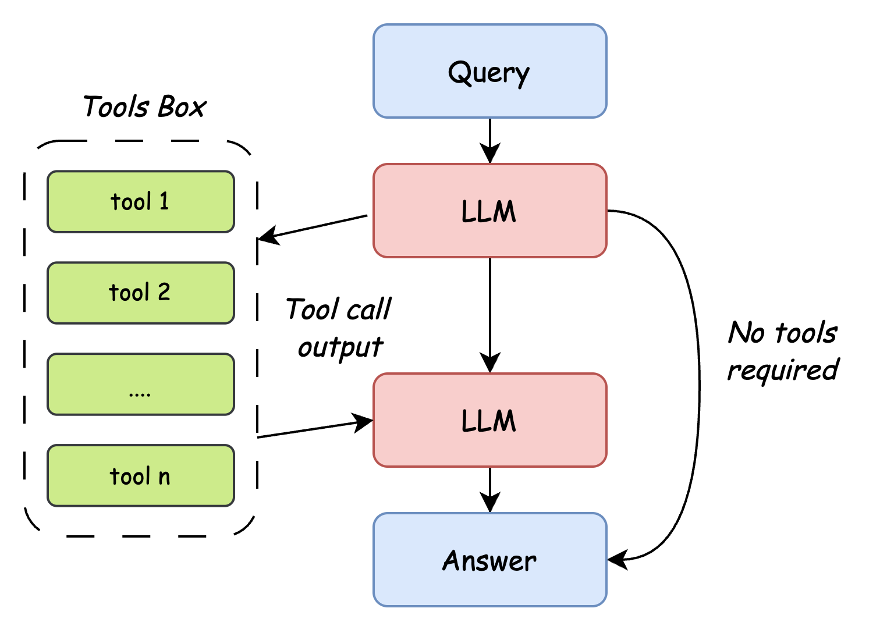

# TinyAgent 技术方案文档

## 一、项目概述

### 1.1 什么是 TinyAgent？

TinyAgent 是一个**极简的 AI Agent（智能代理）框架**，它能让大语言模型（LLM）具备调用外部工具的能力。在 V2 方案中，项目进一步加入了**记忆机制（Memory）**，让 Agent 不仅能调用工具，还能跨轮次、跨会话保留和检索关键信息。

**通俗理解**：
- 想象你是一个秘书（LLM），老板问你"现在几点了？"
- 你本身没有手表（不知道时间）
- 但你知道可以看墙上的钟表（调用工具）
- 于是你看了钟表，告诉老板准确时间

**Agent 的核心价值**：让大模型从"只会聊天"变成"能动手做事"

### 1.2 项目特点

| 特点 | 说明 |
|------|------|
| **极简设计** | 核心代码不到 80 行，新手友好 |
| **工具扩展** | 可轻松添加自定义工具函数 |
| **记忆机制** | 支持短期记忆、工作记忆、长期记忆 |
| **双端支持** | 支持命令行和 Web 界面 |
| **中文优化** | 针对中文场景优化 |

---

## 二、前置知识

### 2.1 你需要了解什么？

在开始之前，请确保你理解以下概念：

#### 2.1.1 大语言模型（LLM）

大语言模型就像一个读过海量书籍的"学霸"，能回答问题、写文章、编代码。但它有局限性：

- ❌ 不知道实时信息（如当前时间、天气）
- ❌ 无法与外部世界交互（如查数据库、发邮件）
- ❌ 某些专业知识可能过时

**解决方案**：给 LLM 配上"工具"，让它在需要时使用。

#### 2.1.2 Function Calling（函数调用）

这是 OpenAI 等大模型支持的功能：

```
用户提问: "北京今天天气怎么样？"
          ↓
LLM 思考: "我不知道实时天气，但我有 search_weather 工具"
          ↓
LLM 输出: 调用意图 { "tool": "search_weather", "city": "北京" }
          ↓
程序执行: 调用 search_weather("北京") → "晴天，25°C"
          ↓
LLM 生成: "北京今天晴天，气温25度，适合出门！"
```

#### 2.1.3 JSON Schema

为了让 LLM 知道如何使用工具，我们需要用标准化的格式描述工具：

```json
{
  "type": "function",
  "function": {
    "name": "add",
    "description": "计算两个数的和",
    "parameters": {
      "type": "object",
      "properties": {
        "a": {"type": "number"},
        "b": {"type": "number"}
      },
      "required": ["a", "b"]
    }
  }
}
```

#### 2.1.4 Memory（记忆机制）

在基础 Agent 中，`messages` 只能保存当前进程内的对话上下文，这种能力更接近**短期记忆**。如果程序重启，或对话非常长，Agent 就会遗忘早先的信息。

为了让 Agent 更像一个“持续工作的智能体”，我们通常会加入记忆机制。常见的记忆类型有：

- **短期记忆**：当前对话窗口中的消息历史
- **工作记忆**：针对当前任务提炼出的阶段性摘要
- **长期记忆**：跨会话保存的稳定信息、偏好、事实和经验

记忆机制的核心不是“把所有对话都存下来”，而是：

1. **提炼**出值得保留的信息
2. **存储**到可持久化的数据结构中
3. 在新问题到来时，**召回**最相关的记忆

#### 2.1.5 Embedding 与向量检索

V2 版本的长期记忆不再只依赖关键词匹配，而是引入**Embedding（向量表示）**的设计思路。

通俗理解：

- 把一段文本变成一串数字向量
- 语义相近的文本，在向量空间里距离更近
- 当用户提出新问题时，可以把问题也转成向量
- 再去记忆库里找到“语义最相似”的几条记忆

这使得 Agent 即使碰到措辞不同但语义相近的问题，也能召回正确的历史信息。

在本项目的 V2 设计中，向量检索不再直接依赖 SQLite，而是交给 **ChromaDB** 负责。这样学生可以更清晰地理解：

- SQLite 负责结构化元数据存储
- ChromaDB 负责向量索引、相似度检索和 top-k 召回
- Agent 在召回阶段同时利用两者的能力

---

## 三、架构设计

### 3.1 系统架构图

```
┌─────────────────────────────────────────────────────────┐
│                      用户交互层                          │
│  ┌─────────────┐    ┌─────────────┐                     │
│  │  demo.py    │    │ web_demo.py │                     │
│  │ (命令行)     │    │ (Web界面)   │                     │
│  └──────┬──────┘    └──────┬──────┘                     │
└─────────┼──────────────────┼───────────────────────────┘
          │                  │
          └────────┬─────────┘
                   ↓
┌─────────────────────────────────────────────────────────┐
│                      Agent 核心层                        │
│                    ┌─────────┐                          │
│                    │ Agent类 │                          │
│                    └────┬────┘                          │
│      ┌──────────┬──────────┬──────────┬──────────┐      │
│      ↓          ↓          ↓          ↓          │      │
│  ┌──────────┐┌──────────┐┌──────────┐┌──────────┐│      │
│  │对话管理  ││工具调用  ││记忆召回  ││记忆写回  ││      │
│  │messages  ││handle_   ││recall    ││writeback ││      │
│  └──────────┘└──────────┘└──────────┘└──────────┘│      │
└─────────────────────────────────────────────────────────┘
                   ↓
┌─────────────────────────────────────────────────────────┐
│                      记忆层                              │
│  ┌──────────┐ ┌──────────┐ ┌──────────┐ ┌────────────┐ │
│  │短期记忆  │ │工作记忆  │ │长期记忆  │ │向量检索    │ │
│  │messages  │ │summary   │ │SQLite    │ │ChromaDB    │ │
│  └──────────┘ └──────────┘ └──────────┘ └────────────┘ │
└─────────────────────────────────────────────────────────┘
                   ↓
┌─────────────────────────────────────────────────────────┐
│                      工具层                              │
│  ┌──────────┐ ┌──────────┐ ┌──────────┐ ┌──────────┐   │
│  │获取时间  │ │数学计算  │ │字符串    │ │维基百科  │   │
│  │          │ │          │ │统计      │ │搜索      │   │
│  └──────────┘ └──────────┘ └──────────┘ └──────────┘   │
└─────────────────────────────────────────────────────────┘
                   ↓
┌─────────────────────────────────────────────────────────┐
│                      LLM 接口层                          │
│                   OpenAI API                             │
│         (支持 SiliconFlow、Embedding 模型等)             │
└─────────────────────────────────────────────────────────┘
```

### 3.2 核心流程图

<div style="display: flex; justify-content: center;">
    
</div>

```
┌────────┐
│ 用户输入 │
└───┬────┘
    ↓
┌────────────────────────┐
│ 1. 读取短期记忆         │
│ 当前 messages          │
└───┬────────────────────┘
    ↓
┌────────────────────────┐
│ 2. 检索长期记忆         │
│ 向量召回 + 规则过滤     │
└───┬────────────────────┘
    ↓
┌────────────────────────┐
│ 3. 构建 Prompt         │
│ 用户问题 + 记忆 + 工具  │
└───┬────────────────────┘
    ↓
┌────────────────────────┐
│ 4. 调用 LLM            │
│ 判断是否需要工具        │
└───┬────────────────────┘
    ↓
┌────────────────────────┐
│ 5. LLM 决策            │
│ 是否需要调用工具？      │
└───┬────────────────────┘
    │
    ├──────────┬──────────┐
    ↓          │          ↓
不需要        │        需要
    ↓          │          ↓
┌────────┐     │    ┌────────────────┐
│直接回答│     │    │ 6. 调用工具函数 │
└───┬────┘     │    └───────┬────────┘
    │          │            ↓
    │          │    ┌────────────────┐
    │          │    │ 7. 返回结果     │
    │          │    │ 给 LLM         │
    │          │    └───────┬────────┘
    │          │            ↓
    │          │    ┌────────────────┐
    │          └───→│ 8. LLM 生成     │
    │               │ 最终回答        │
    │               └───────┬────────┘
    │                       ↓
    └──────────┬────────────┘
               ↓
┌────────────────────────┐
│ 9. 提炼新记忆           │
│ facts/preferences/task │
└───┬────────────────────┘
    ↓
┌────────────────────────┐
│ 10. 写回长期记忆        │
│ SQLite + ChromaDB       │
└───┬────────────────────┘
    ↓
┌────────────┐
│ 返回给用户 │
└────────────┘
```

---

## 四、模块详解

### 4.1 项目目录结构

```
TinyAgent-public/
├── src/                      # 核心源码目录
│   ├── __init__.py           # 包初始化（空文件）
│   ├── core.py               # Agent 核心类
│   ├── memory.py             # 记忆管理器
│   ├── store.py              # 记忆存储与检索
│   ├── vector_store.py       # ChromaDB 向量检索封装
│   ├── tools.py              # 工具函数定义
│   └── utils.py              # 工具辅助函数
├── data/                     # 本地数据目录
│   ├── memory.db             # SQLite 记忆数据库
│   └── chroma/               # ChromaDB 本地持久化目录
├── demo.py                   # 命令行演示程序
├── web_demo.py               # Streamlit Web 演示
├── requirements.txt          # 依赖列表
├── README.md                 # 项目说明
└── images/                   # 图片资源
    ├── example.gif
    └── Tiny_Agent.jpg
```

### 4.2 utils.py - 工具描述生成

**作用**：将 Python 函数自动转换为 LLM 能理解的 JSON Schema 格式。

**核心原理**：使用 Python 的 `inspect` 模块自动分析函数签名。

```python
import inspect

# Python 类型 → JSON 类型的映射表
type_map = {
    str: "string",
    int: "integer",
    float: "number",
    bool: "boolean",
    list: "array",
    dict: "object",
}

def function_to_json(func):
    """
    将函数转换为 OpenAI Tool Schema 格式
    
    示例：
    def add(a: float, b: float) -> str:
        '''计算两数之和'''
        return str(a + b)
    
    转换后：
    {
        "type": "function",
        "function": {
            "name": "add",
            "description": "计算两数之和",
            "parameters": {
                "type": "object",
                "properties": {
                    "a": {"type": "number"},
                    "b": {"type": "number"}
                },
                "required": ["a", "b"]
            }
        }
    }
    """
    # 获取函数签名
    signature = inspect.signature(func)
    
    # 解析参数
    parameters = {}
    for param in signature.parameters.values():
        param_type = type_map.get(param.annotation, "string")
        parameters[param.name] = {"type": param_type}
    
    # 判断哪些参数是必需的（没有默认值的）
    required = [
        param.name
        for param in signature.parameters.values()
        if param.default == inspect._empty  # 没有默认值
    ]
    
    return {
        "type": "function",
        "function": {
            "name": func.__name__,
            "description": func.__doc__ or "",
            "parameters": {
                "type": "object",
                "properties": parameters,
                "required": required,
            },
        },
    }
```

**关键点**：
- `inspect.signature(func)`：获取函数的参数信息
- `param.annotation`：获取参数的类型注解（如 `a: float` 中的 `float`）
- `param.default`：获取参数的默认值

### 4.3 tools.py - 工具定义

**作用**：定义 Agent 可以调用的具体工具函数。

```python
from datetime import datetime
import wikipedia

def get_current_datetime() -> str:
    """
    获取当前日期和时间。
    :return: 当前日期和时间的字符串表示。
    """
    current_datetime = datetime.now()
    formatted_datetime = current_datetime.strftime("%Y-%m-%d %H:%M:%S")
    return formatted_datetime

def add(a: float, b: float) -> str:
    """
    计算两个浮点数的和。
    :param a: 第一个浮点数。
    :param b: 第二个浮点数。
    :return: 两个浮点数的和。
    """
    return str(a + b)

def compare(a: float, b: float) -> str:
    """
    比较两个浮点数的大小。
    :param a: 第一个浮点数。
    :param b: 第二个浮点数。
    :return: 比较结果的字符串表示。
    """
    if a > b:
        return f'{a} is greater than {b}'
    elif a < b:
        return f'{b} is greater than {a}'
    else:
        return f'{a} is equal to {b}'

def count_letter_in_string(a: str, b: str) -> str:
    """
    统计字符串中某个字母的出现次数。
    :param a: 要搜索的字符串。
    :param b: 要统计的字母。
    :return: 字母在字符串中出现的次数。
    """
    string = a.lower()
    letter = b.lower()
    count = string.count(letter)
    return f"The letter '{letter}' appears {count} times in the string."

def search_wikipedia(query: str) -> str:
    """
    在维基百科中搜索指定查询的前三个页面摘要。
    :param query: 要搜索的查询字符串。
    :return: 包含前三个页面摘要的字符串。
    """
    page_titles = wikipedia.search(query)
    summaries = []
    for page_title in page_titles[:3]:
        try:
            wiki_page = wikipedia.page(title=page_title, auto_suggest=False)
            summaries.append(f"页面: {page_title}\n摘要: {wiki_page.summary}")
        except (wikipedia.exceptions.PageError, wikipedia.exceptions.DisambiguationError):
            pass
    if not summaries:
        return "维基百科没有搜索到合适的结果"
    return "\n\n".join(summaries)
```

**工具编写规范**：

1. **必须有 docstring**：用于描述工具功能
2. **参数必须有类型注解**：如 `a: float, b: float`
3. **返回值必须是字符串**：LLM 接收文本输入
4. **参数描述要写清楚**：`:param x: 参数说明`

### 4.4 core.py - Agent 核心类

**作用**：实现 Agent 的完整逻辑。在 V2 版本中，`core.py` 不再只负责“对话 + 工具调用”，还要负责把记忆机制嵌入主流程。

```python
from openai import OpenAI
import json
from typing import List, Dict, Any
from src.utils import function_to_json

# 系统提示词，定义 Agent 的角色和行为
SYSTEM_PROMPT = """
你是一个叫不要葱姜蒜的人工智能助手。你的输出应该与用户的语言保持一致。
当用户的问题需要调用工具时，你可以从提供的工具列表中调用适当的工具函数。
"""

class Agent:
    def __init__(
        self,
        client: OpenAI,
        model: str = "Qwen/Qwen2.5-32B-Instruct",
        tools: List = [],
        memory_manager=None,
        user_id: str = "default_user",
        verbose: bool = True,
    ):
        """
        初始化 Agent
        
        :param client: OpenAI 客户端实例
        :param model: 使用的模型名称
        :param tools: 可用的工具函数列表
        :param verbose: 是否打印调试信息
        """
        self.client = client        # OpenAI API 客户端
        self.tools = tools          # 工具函数列表
        self.model = model          # 模型名称
        self.memory_manager = memory_manager  # 记忆管理器
        self.user_id = user_id      # 当前用户标识
        self.verbose = verbose      # 调试模式
        
        # 对话历史记录（包含系统提示）
        self.messages = [
            {"role": "system", "content": SYSTEM_PROMPT},
        ]

    def get_tool_schema(self) -> List[Dict[str, Any]]:
        """
        获取所有工具的 JSON Schema 描述
        用于传递给 LLM，让它知道有哪些工具可用
        """
        return [function_to_json(tool) for tool in self.tools]

    def handle_tool_call(self, tool_call):
        """
        处理 LLM 请求的工具调用
        
        :param tool_call: LLM 返回的工具调用请求
        :return: 工具执行结果消息
        """
        # 提取工具调用信息
        function_name = tool_call.function.name      # 函数名
        function_args = tool_call.function.arguments # 参数（JSON字符串）
        function_id = tool_call.id                   # 调用ID
        
        # 执行工具函数
        # eval(f"{function_name}(**{function_args})") 会动态执行函数
        # 例如：eval("add(**{'a': 1, 'b': 2})") → add(a=1, b=2)
        function_call_content = eval(f"{function_name}(**{function_args})")
        
        # 返回结果消息（tool 类型）
        return {
            "role": "tool",
            "content": str(function_call_content),
            "tool_call_id": function_id,
        }

    def get_completion(self, prompt: str) -> str:
        """
        处理用户输入，获取回复
        
        这是 Agent 的核心逻辑，包含完整的对话流程
        """
        # 1. 将用户消息加入短期记忆
        self.messages.append({"role": "user", "content": prompt})

        # 2. 从长期记忆中召回相关内容
        recalled_memories = []
        if self.memory_manager:
            recalled_memories = self.memory_manager.recall(
                user_id=self.user_id,
                query=prompt,
                top_k=5,
            )

        # 3. 将记忆摘要注入上下文
        if recalled_memories:
            memory_prompt = self.memory_manager.format_for_prompt(recalled_memories)
            self.messages.append({
                "role": "system",
                "content": f"以下是与当前问题相关的历史记忆：\n{memory_prompt}"
            })

        # 4. 第一次调用 LLM，传入工具描述
        response = self.client.chat.completions.create(
            model=self.model,
            messages=self.messages,
            tools=self.get_tool_schema(),  # 告诉 LLM 有哪些工具
            stream=False,
        )
        
        # 5. 检查 LLM 是否需要调用工具
        if response.choices[0].message.tool_calls:
            # LLM 想调用工具
            
            # 将 LLM 的回复加入历史（包含 tool_calls 信息）
            self.messages.append({
                "role": "assistant", 
                "content": response.choices[0].message.content
            })
            
            # 处理所有工具调用请求
            tool_list = []
            for tool_call in response.choices[0].message.tool_calls:
                # 执行工具，获取结果
                result = self.handle_tool_call(tool_call)
                self.messages.append(result)  # 加入历史
                
                tool_list.append([
                    tool_call.function.name, 
                    tool_call.function.arguments
                ])
            
            # 打印调试信息
            if self.verbose:
                print("调用工具：", response.choices[0].message.content, tool_list)
            
            # 5. 第二次调用 LLM，传入工具执行结果
            response = self.client.chat.completions.create(
                model=self.model,
                messages=self.messages,
                tools=self.get_tool_schema(),
                stream=False,
            )

        # 6. 将最终回复加入历史
        self.messages.append({
            "role": "assistant", 
            "content": response.choices[0].message.content
        })

        # 7. 从本轮对话中提炼新记忆并写回
        if self.memory_manager:
            self.memory_manager.write_back(
                user_id=self.user_id,
                user_message=prompt,
                assistant_message=response.choices[0].message.content,
            )

        # 8. 返回最终回复
        return response.choices[0].message.content
```

**核心逻辑解析**：

#### V2 中的对话与记忆流程管理

```
┌─────────────────────────────────────────────────────────────┐
│                    短期记忆: messages                       │
├─────────────────────────────────────────────────────────────┤
│ 1. system: 角色设定                                         │
│ 2. user: 当前输入                                            │
│ 3. system: 注入召回到的长期记忆                              │
│ 4. assistant: 可能包含 tool_calls                           │
│ 5. tool: 工具返回结果                                        │
│ 6. assistant: 最终回答                                       │
└─────────────────────────────────────────────────────────────┘

┌─────────────────────────────────────────────────────────────┐
│                长期记忆元数据: SQLite                      │
├─────────────────────────────────────────────────────────────┤
│ id | user_id | memory_type | content | importance | topic │
├─────────────────────────────────────────────────────────────┤
│ 1  | u001    | fact        | 用户喜欢中文回答 | 0.92 | ui │
│ 2  | u001    | preference  | 喜欢先看例子再看解释 | 0.88 | style │
│ 3  | u001    | task        | 正在开发一个天气 Agent | 0.76 | project │
└─────────────────────────────────────────────────────────────┘

┌─────────────────────────────────────────────────────────────┐
│                向量索引与召回: ChromaDB                    │
├─────────────────────────────────────────────────────────────┤
│ id=1 -> embedding=[...]                                    │
│ id=2 -> embedding=[...]                                    │
│ id=3 -> embedding=[...]                                    │
│ query -> similarity_search(top_k=5)                        │
└─────────────────────────────────────────────────────────────┘
```

#### 两次调用 LLM 的原因

1. **第一次调用**：告诉 LLM 有哪些工具，让它判断是否需要调用
2. **第二次调用**：将工具执行结果告诉 LLM，让它生成自然语言回复

```
第一次调用：
用户: "现在几点？"
LLM: 我需要调用 get_current_datetime()
     ↓
程序执行工具
     ↓
第二次调用：
用户: "现在几点？"
工具结果: "2024-01-01 12:00:00"
LLM: 现在是 2024年1月1日中午12点整
```

### 4.5 memory.py - 记忆管理器

**作用**：统一管理短期记忆、工作记忆、长期记忆之间的协作关系。

V2 版本建议把记忆管理抽象成单独模块，而不是把所有逻辑都塞进 `core.py`。这样更利于教学，也更接近真实工程实践。

#### 4.5.1 三层记忆划分

| 记忆类型 | 存储位置 | 生命周期 | 作用 |
|----------|----------|----------|------|
| 短期记忆 | `self.messages` | 单次会话内 | 保证多轮对话连贯 |
| 工作记忆 | `summary` 字段 | 当前任务阶段 | 压缩历史，降低上下文长度 |
| 长期记忆 | SQLite + ChromaDB | 跨会话持久化 | 保存稳定事实、偏好、经验 |

#### 4.5.2 长期记忆的数据模型

长期记忆不建议直接保存完整原始对话，而应保存结构化条目：

```python
{
    "id": 1,
    "user_id": "default_user",
    "memory_type": "preference",
    "content": "用户希望回答尽量简洁，并优先给出代码示例。",
    "importance": 0.85,
    "created_at": "2026-04-27 10:30:00",
    "last_accessed_at": "2026-04-27 11:20:00",
    "source": "conversation",
}
```

推荐的 `memory_type` 包括：

- `profile`：用户基本身份信息
- `preference`：回复风格、语言偏好、展示偏好
- `fact`：与用户长期相关的稳定事实
- `task`：当前正在推进的任务
- `experience`：历史经验、结论、踩坑记录

#### 4.5.3 记忆召回流程

V2 召回机制建议采用“两阶段检索”：

1. **规则过滤**
按 `user_id`、`memory_type`、时间范围先缩小候选集

2. **向量召回**
将当前用户问题转成 embedding，在 ChromaDB 中做相似度检索，取 top-k

3. **重排序**
结合语义相似度、重要性分数、最近访问时间做综合排序

最终只把少量高价值记忆注入 Prompt，避免上下文膨胀。

#### 4.5.4 记忆写回流程

每轮对话结束后，不应无脑写入所有内容，而应进行提炼：

1. 从用户输入和 Agent 回复中抽取候选记忆
2. 判断是否属于“值得长期保存的信息”
3. 为记忆打上类型和重要性分数
4. 写入 SQLite
5. 写入 ChromaDB，建立对应的 embedding 索引

可通过规则与 LLM 相结合的方式实现：

- 规则负责过滤明显无价值内容
- LLM 负责总结和结构化提炼

#### 4.5.5 工作记忆的作用

工作记忆用于保存“当前任务的阶段性状态”，例如：

- 用户正在实现哪个功能
- 上一轮已经做了什么决定
- 还有哪些待完成步骤

它通常不是永久记忆，而是定期覆盖更新。例如每 6 到 10 轮对话生成一次摘要，替换掉过长的历史消息。

### 4.6 store.py - 存储与检索层

**作用**：负责把记忆安全地落到本地存储中，并提供统一的结构化查询接口。

#### 4.6.1 为什么 V2 仍然保留 SQLite

即使已经引入 ChromaDB，SQLite 仍然有价值，因为它非常适合保存结构化元数据：

1. 支持结构化查询，便于按用户、类型、时间过滤
2. 支持更新和去重，避免一份 JSON 文件越写越乱
3. 教学成本适中，学生容易理解
4. 可以和 ChromaDB 分工协作，职责更清晰

#### 4.6.2 推荐表结构

```sql
CREATE TABLE memories (
    id INTEGER PRIMARY KEY AUTOINCREMENT,
    user_id TEXT NOT NULL,
    memory_type TEXT NOT NULL,
    content TEXT NOT NULL,
    importance REAL DEFAULT 0.5,
    chroma_id TEXT,
    created_at TEXT NOT NULL,
    last_accessed_at TEXT,
    source TEXT DEFAULT 'conversation'
);
```

如果希望进一步优化，还可以增加：

- `hash`：用于去重
- `topic`：用于按主题检索
- `is_active`：用于软删除和记忆失效管理

其中 `chroma_id` 用于把 SQLite 中的结构化记录，与 ChromaDB 中的向量条目关联起来。

#### 4.6.3 存储层接口设计

```python
class MemoryStore:
    def add_memory(self, user_id, memory_type, content, importance, chroma_id):
        pass

    def list_memories(self, user_id, memory_type=None):
        pass

    def get_memories_by_ids(self, ids):
        pass

    def update_access_time(self, memory_ids):
        pass
```

通过这样的接口拆分，`core.py` 只关心“要不要用记忆”，而不需要关心底层 SQL 细节。

### 4.7 vector_store.py - ChromaDB 向量层

**作用**：负责 embedding 的写入、更新和相似度检索。

这一层建议单独封装，不要直接把 ChromaDB 调用逻辑散落在 `memory.py` 或 `core.py` 里。这样学生可以清楚地看到：

- `store.py` 管结构化数据
- `vector_store.py` 管语义检索
- `memory.py` 负责把两者串起来

#### 4.7.1 为什么选择 ChromaDB

在这个项目里，ChromaDB 比“把 embedding 直接塞进 SQLite 再用 Python 手算相似度”更适合 V2 教学版，原因有：

1. 更符合真实项目里的向量检索分层思路
2. API 相对直观，便于学生理解 collection、query、top-k 等概念
3. 支持本地持久化，适合这个轻量项目
4. 后续扩展到 RAG、知识库检索时更自然

#### 4.7.2 推荐接口设计

```python
class VectorStore:
    def add_text(self, doc_id, text, metadata=None):
        pass

    def search(self, query_text, top_k=5, filters=None):
        pass

    def delete(self, doc_id):
        pass

    def update(self, doc_id, text, metadata=None):
        pass
```

#### 4.7.3 召回链路示例

1. 用户输入问题
2. `vector_store.py` 调用 ChromaDB 做语义检索，拿到一组 `doc_id`
3. `store.py` 根据这些 `doc_id` 或映射后的 `id` 到 SQLite 取完整元数据
4. `memory.py` 负责重排序、裁剪、格式化
5. `core.py` 把结果注入 Prompt

这种拆分能让整个记忆系统更容易观察，也更方便后续替换底层组件。

### 4.8 demo.py - 命令行演示

**作用**：命令行交互界面。

```python
from src.core import Agent
from src.memory import MemoryManager
from src.store import MemoryStore
from src.vector_store import VectorStore
from src.tools import add, count_letter_in_string, compare, get_current_datetime, search_wikipedia
from openai import OpenAI
import os

if __name__ == "__main__":
    # 1. 初始化 OpenAI 客户端
    client = OpenAI(
        api_key=os.getenv("DEEPSEEK_API_KEY", "your deepseek api key"),
        base_url="https://api.deepseek.com",
    )

    # 2. 初始化记忆系统
    store = MemoryStore(db_path="data/memory.db")
    vector_store = VectorStore(persist_directory="data/chroma")
    memory_manager = MemoryManager(client=client, store=store, vector_store=vector_store)

    # 3. 创建 Agent 实例
    agent = Agent(
        client=client,
        model="deepseek-v4-flash",
        memory_manager=memory_manager,
        user_id="cli_user_001",
        tools=[get_current_datetime, add, compare, count_letter_in_string, search_wikipedia],
    )

    # 4. 交互循环
    while True:
        # \033[94m 是蓝色 ANSI 颜色代码
        prompt = input("\033[94mUser: \033[0m")
        
        if prompt.lower() == "exit":
            break
        
        # 获取 Agent 回复
        response = agent.get_completion(prompt)
        
        # \033[92m 是绿色 ANSI 颜色代码
        print("\033[92mAssistant: \033[0m", response)
```

### 4.9 web_demo.py - Web 演示

**作用**：使用 Streamlit 构建 Web 界面。

```python
import os
import streamlit as st
from src.core import Agent
from src.memory import MemoryManager
from src.store import MemoryStore
from src.vector_store import VectorStore
from src.tools import add, count_letter_in_string, compare, get_current_datetime, search_wikipedia
from openai import OpenAI

# 页面配置
st.set_page_config(
    page_title="Tiny Agent Demo",
    page_icon="🤖",
    layout="centered",
)

# 初始化 OpenAI 客户端
client = OpenAI(
    api_key=os.getenv("DEEPSEEK_API_KEY", "your deepseek api key"),
    base_url="https://api.deepseek.com",
)

store = MemoryStore(db_path="data/memory.db")
vector_store = VectorStore(persist_directory="data/chroma")
memory_manager = MemoryManager(client=client, store=store, vector_store=vector_store)

# 使用 @st.cache_resource 缓存 Agent 实例
@st.cache_resource
def load_agent():
    return Agent(
        client=client,
        model="deepseek-v4-flash",
        memory_manager=memory_manager,
        user_id="web_user_001",
        tools=[get_current_datetime, add, compare, count_letter_in_string, search_wikipedia],
    )

agent = load_agent()

# UI
st.title("🤖 Happy-LLM Tiny Agent")
st.markdown("欢迎来到 Tiny Agent web 界面！")

# 初始化聊天记录
if "messages" not in st.session_state:
    st.session_state.messages = []

# 显示历史消息
for message in st.session_state.messages:
    with st.chat_message(message["role"]):
        st.markdown(message["content"])

# 处理用户输入
if prompt := st.chat_input("我能为您做些什么？"):
    # 显示用户消息
    st.chat_message("user").markdown(prompt)
    st.session_state.messages.append({"role": "user", "content": prompt})

    # 显示加载动画
    with st.spinner('思考中...'):
        response = agent.get_completion(prompt)
    
    # 显示助手回复
    st.chat_message("assistant").markdown(response)
    st.session_state.messages.append({"role": "assistant", "content": response})
```

---

## 五、开发指南

### 5.1 环境搭建

#### 步骤 1：克隆代码

```bash
git clone https://github.com/your-repo/TinyAgent.git
cd TinyAgent
```

#### 步骤 2：创建虚拟环境

```bash
# 创建虚拟环境
python3 -m venv .venv

# 激活虚拟环境
# macOS/Linux:
source .venv/bin/activate
# Windows:
# .venv\Scripts\activate
```

#### 步骤 3：安装依赖

```bash
pip install -r requirements.txt
```

核心依赖说明：

| 依赖 | 版本 | 说明 |
|------|------|------|
| openai | >=1.0 | OpenAI API 客户端 |
| streamlit | >=1.0 | Web 界面框架 |
| wikipedia | >=1.4 | 维基百科 API |
| sqlite3 | Python内置 | 持久化长期记忆 |
| chromadb | 建议安装 | 本地向量数据库 |
| embedding 模型 | 可选 | 生成文本向量用于语义召回 |

#### 步骤 4：准备本地数据目录

```bash
mkdir -p data/chroma
```

这个目录用于保存：

- `data/memory.db`：SQLite 结构化记忆数据库
- `data/chroma/`：ChromaDB 向量索引持久化目录

#### 步骤 5：配置 API Key

当前项目默认使用 **DeepSeek 官方 API**。推荐通过环境变量注入 API Key，而不是直接写死在代码里。

macOS/Linux:

```bash
export DEEPSEEK_API_KEY="your_deepseek_api_key"
```

Windows PowerShell:

```powershell
$env:DEEPSEEK_API_KEY="your_deepseek_api_key"
```

代码中的默认初始化方式如下：

```python
client = OpenAI(
    api_key=os.getenv("DEEPSEEK_API_KEY", "your deepseek api key"),
    base_url="https://api.deepseek.com",
)
```

**获取 API Key**：
1. 访问 [DeepSeek 平台](https://platform.deepseek.com/) 注册账号
2. 创建 API Key
3. 配置到环境变量 `DEEPSEEK_API_KEY`

### 5.2 部署步骤

下面给出一套从零开始可直接运行的部署流程。

#### 命令行版本部署

```bash
git clone https://github.com/your-repo/TinyAgent.git
cd TinyAgent
python3 -m venv .venv
source .venv/bin/activate
pip install -r requirements.txt
mkdir -p data/chroma
export DEEPSEEK_API_KEY="your_deepseek_api_key"
python3 demo.py
```

#### Web 版本部署

```bash
git clone https://github.com/your-repo/TinyAgent.git
cd TinyAgent
python3 -m venv .venv
source .venv/bin/activate
pip install -r requirements.txt
mkdir -p data/chroma
export DEEPSEEK_API_KEY="your_deepseek_api_key"
streamlit run web_demo.py
```

#### 首次启动说明

第一次运行带记忆功能的版本时，ChromaDB 可能会自动下载默认的 embedding 模型，因此首次启动会比后续启动慢一些，这是正常现象。

#### 启动后的产物

成功运行后，项目目录下通常会出现或更新以下文件：

- `data/memory.db`
- `data/chroma/`

这说明长期记忆的结构化存储和向量索引都已经开始工作。

### 5.3 运行程序

#### 命令行版本

```bash
python3 demo.py
```

#### Web 版本

```bash
streamlit run web_demo.py
```

浏览器会自动打开 `http://localhost:8501`

### 5.4 添加自定义工具

**示例：添加天气查询工具**

在 `src/tools.py` 中添加：

```python
import requests

def get_weather(city: str) -> str:
    """
    查询指定城市的天气。
    :param city: 城市名称，如"北京"、"上海"。
    :return: 天气信息。
    """
    # 使用第三方天气 API（需要注册获取 Key）
    url = f"https://api.example.com/weather?city={city}"
    response = requests.get(url)
    data = response.json()
    
    return f"{city}今天{data['weather']}，气温{data['temp']}度"
```

在 `demo.py` 中注册工具：

```python
from src.tools import get_weather  # 导入新工具

agent = Agent(
    client=client,
    model="Qwen/Qwen2.5-72B-Instruct",
    tools=[
        get_current_datetime, 
        add, 
        compare, 
        count_letter_in_string, 
        search_wikipedia,
        get_weather  # 添加到工具列表
    ],
)
```

**工具开发最佳实践**：

1. **参数尽量简单**：使用基础类型（str, int, float, bool）
2. **返回值是字符串**：LLM 只接收文本
3. **添加错误处理**：防止工具崩溃影响整个 Agent
4. **文档要写清楚**：影响 LLM 对工具的理解

---

## 六、常见问题

### Q1: LLM 不调用工具怎么办？

**可能原因**：
1. 工具描述不够清晰
2. LLM 认为不需要工具
3. 模型不支持 Function Calling

**解决方案**：
```python
# 在系统提示中强调使用工具
SYSTEM_PROMPT = """
你是一个AI助手。当用户问时间、计算、搜索等问题时，
**必须**调用相应的工具函数，不要直接猜测。
"""
```

### Q2: 工具调用参数错误？

**可能原因**：
1. 参数类型不匹配
2. 缺少必需参数
3. 参数格式错误

**解决方案**：
```python
# 在工具函数中添加参数校验
def add(a: float, b: float) -> str:
    """..."""
    try:
        result = float(a) + float(b)
        return str(result)
    except (ValueError, TypeError) as e:
        return f"参数错误: {e}"
```

### Q3: 对话历史太长？

**解决方案**：实现上下文截断

```python
class Agent:
    def manage_context(self):
        """管理对话历史长度"""
        # 保留系统消息 + 最近 10 轮对话
        if len(self.messages) > 20:
            self.messages = [self.messages[0]] + self.messages[-19:]
```

### Q4: 为什么不能把所有聊天记录都存成长期记忆？

**原因**：
1. 噪声太多，会污染召回结果
2. 存储成本和检索成本都会持续上升
3. 很多内容只对当下有用，不适合长期保存

**解决方案**：

- 对长期记忆做类型化存储
- 引入重要性评分
- 定期归档低价值记忆
- 只把“稳定、可复用、跨会话有价值”的内容写入长期记忆

### Q5: 引入向量检索后会不会太复杂？

对生产系统来说，向量检索是常见做法；对教学项目来说，可以按两步实现：

1. 先用 SQLite 存结构化记忆
2. 再引入 ChromaDB 做语义检索

这样学生既能理解完整架构，也能更自然地接受“结构化存储”和“向量存储”分层的思想。

---

## 七、进阶扩展

### 7.1 记忆淘汰与压缩

随着长期记忆不断增加，还需要考虑“遗忘机制”。常见策略有：

1. **按重要性淘汰**：低分记忆优先删除
2. **按时间衰减**：长期未访问的记忆逐渐降权
3. **按主题压缩**：把多条相似记忆合并为一条摘要

一个简单的衰减公式示例：

```python
def decay_score(importance: float, days_unused: int) -> float:
    return max(0.0, importance - days_unused * 0.01)
```

### 7.2 支持多轮工具调用

当前实现只支持一次工具调用，可以扩展为链式调用：

```python
def get_completion(self, prompt: str) -> str:
    self.messages.append({"role": "user", "content": prompt})
    
    # 循环调用，直到不需要工具
    while True:
        response = self.client.chat.completions.create(
            model=self.model,
            messages=self.messages,
            tools=self.get_tool_schema(),
            stream=False,
        )
        
        if not response.choices[0].message.tool_calls:
            # 不再调用工具，结束循环
            break
        
        # 处理工具调用...
        # ...
    
    return response.choices[0].message.content
```

### 7.3 异步支持

使用 `async/await` 提高并发性能：

```python
import asyncio
from openai import AsyncOpenAI

class AsyncAgent:
    def __init__(self):
        self.client = AsyncOpenAI(api_key="...")
    
    async def get_completion(self, prompt: str) -> str:
        # 异步调用 API
        response = await self.client.chat.completions.create(
            model=self.model,
            messages=self.messages,
        )
        return response.choices[0].message.content
```

### 7.4 工具调用可视化

在 Web 界面显示工具调用过程：

```python
if response.choices[0].message.tool_calls:
    with st.expander("查看工具调用过程"):
        for tool_call in tool_calls:
            st.json({
                "工具": tool_call.function.name,
                "参数": tool_call.function.arguments,
            })
```

### 7.5 记忆可视化与调试面板

为了方便教学，Web 界面还可以增加一个“记忆面板”，展示：

- 本轮召回了哪些记忆
- 每条记忆的类型和重要性分数
- 记忆是通过规则过滤还是 ChromaDB 相似度命中
- 本轮结束后新写入了哪些记忆

这会极大提升学生对 Agent Memory 流程的可观察性。

---

## 八、总结

### 8.1 核心知识点回顾

| 概念 | 说明 |
|------|------|
| Agent | 能调用工具的智能代理 |
| Function Calling | LLM 的函数调用能力 |
| JSON Schema | 描述工具的标准格式 |
| 对话历史 | 维护多轮对话上下文 |
| Memory | 管理短期、工作、长期记忆 |
| Embedding | 把文本转换为向量表示 |
| 向量检索 | 根据语义相似度召回历史记忆 |

### 8.2 项目亮点

1. **代码结构清晰**：核心链路适合教学拆解
2. **易于扩展**：可同时扩展工具机制与记忆机制
3. **从基础到进阶**：覆盖 Function Calling 到 Memory V2
4. **双端支持**：CLI + Web 两种交互方式

### 8.3 学习建议

1. **先跑通基础版**：先理解无记忆的工具调用 Agent
2. **再理解 V2**：重点掌握“召回记忆”和“写回记忆”
3. **先做结构化存储**：先跑通 SQLite 版长期记忆
4. **最后接 ChromaDB**：理解 embedding 如何提升召回质量

---

**祝学习愉快！如有问题，欢迎交流。**
